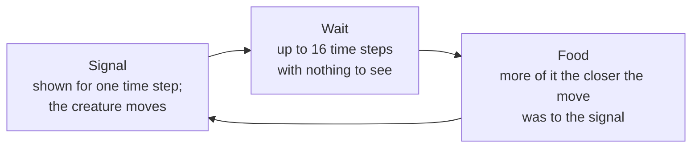

# predictive-coding-agent

**A small neural network that learns to act now for a payoff that comes later.** It is never given a reward to
learn from, and it never tries moves at random. It is built with one goal, to keep one thing it senses (how full it
is) in a comfortable range, and it learns the rest by predicting what it will sense next and correcting its own
mistakes.

> **For researchers.** The agent learns one-step predictions on two clocks: every tick, and its own events. When its
> one-tick forecast, its anticipation and its first level's input weights learn from a prediction error, the error
> is weighted by a running estimate of its own precision; the errors that drive the state are not. Its action is
> inferred while its state settles. The movement descends a function of free-energy form in which the preferences
> are priors in form, taken in the limit where they move the body and reach the state only through that movement. In
> that limit, at the settled state, the movement descends the gradient of the preferences' cost through the agent's
> own forward mapping. In reinforcement-learning terms each outcome follows one decision, and the agent's forecast
> is an action-conditioned Monte Carlo estimate of the change in an interoceptive variable up to its next event,
> which the action follows down its gradient. No reward is delivered, no value is bootstrapped and nothing is added
> for exploration. It is not active inference in the full sense: perception does not feel the preferences, learning
> does not descend the function, and there is no epistemic term. [The precise claims and their
> limits](#for-researchers)

<picture>
  <source media="(prefers-color-scheme: dark)" srcset="docs/summary-dark.svg">
  
</picture>

*What to see: the full agent (blue) climbs past the pass bar (a score close to a perfect player's, defined under
[Results](#results)) and stays there, at each of four delays between its move and its food. With one part switched
off (gray, the same four delays, one run each), it stays below 30% and ends at zero. The score is the share of the
time the creature stays inside its comfortable range, counted over 32 copies of it that play at once and share one
set of learned weights. Each blue line is the average of three runs that start from random weights. Every game and
delay, and the fifth control run, in the second game, are drawn in [docs/results.md](docs/results.md#every-curve). A
point covers 1,000 time steps, so learning that happens inside the first 1,000 does not show. The part switched off
is the look-back explained below.*

## In plain words

**The task.** A simulated creature slowly gets hungry. A signal appears for a single time step and shows it
which way to move. The closer its move is to that direction, the more food it gets, but the food arrives up to
16 time steps later, and nothing happens in between. Then the next signal appears. One round, from signal to
food, is a *trial*. The creature is told none of this. It has to find out that the signal matters, which move
goes with it, and that food arriving now was caused by a move it made a while ago.



**Why that takes something extra.** By the time the food arrives, the moment that earned it is gone, so
something has to connect the two. Learning methods usually do it with a fading record of recent moves, or by
learning how much future reward each situation is worth. This creature keeps one snapshot instead: the last
moment that surprised it.

**How the creature does it.** It is a small neural network, under 900 lines of Python.

- **It has a goal, but gets no reward.** It senses how full it is, and it is built with one goal for that
  sense: keep it inside a comfortable range on the next time step and, looking further ahead to the next signal,
  near the middle of that range. Nothing tells it how good a move was, and the goal is never used to teach it.
  The goal only steers its movement.
- **It learns by predicting.** At every time step it predicts what it will sense next, including how its
  fullness will change. When a prediction turns out wrong, the mistake adjusts its connections. That is the
  only way it learns.
- **It learns most from what it usually predicts well.** For each thing it senses, it keeps track of how large its
  mistakes usually are. A mistake about something it usually predicts well teaches it more than one about
  something it usually gets wrong.
- **It works out its move from its predictions.** Its predictions depend on how it moves. So it asks which way
  of moving would, by its own predictions, bring its fullness back toward the comfortable range, and it turns
  that way. At first its moves are whatever its untrained connections happen to produce. As the predictions
  improve, the moves improve with them. No randomness is added to try things out.
- **One memory bridges the delay.** It remembers the last moment that surprised it, which means a moment when
  what it saw was not what it had predicted. In this task that is the moment of the signal. It keeps what it saw
  and did at that moment, and how full it was. At the next surprise it looks back and measures how its fullness
  really changed in between. If the real change differs from what it expected at the remembered moment, it
  corrects that expectation. The next time the same signal meets the same move, it expects the food, or the lack
  of it, already when it moves, and its goal steers by that. This look-back is called the *hindsight correction*
  in the rest of this page.

**The result.** Starting from random weights, the agent learned its task in all 27 runs: the task above at
seven delays, and a second task with two needs. In every run it then kept the task for at least 100,000 more
time steps. Longer delays mostly took longer to learn, and one run was much slower than the rest. Learning had
a cost: before the task was learned, a copy of the creature went hungry for about 10 to 140 trials on average at
delays of 0 to 2, and for about 50 to 510 at delays of 4 to 16, apart from the slow run at about 3,300.

**Without the look-back.** The usual test of a part like the look-back is to switch it off and see whether
the task is still learned. In that test, the *control*, the agent never learned the task in any of five runs.
That shows it depends on the look-back. It does not show that the delay is the reason: the switched-off agent
also failed with no delay at all, and why was not tracked down.

**What this is, and is not.** It is a small proof of concept, not a benchmark result. A standard method, given
a reward, would be expected to solve a task of this size, and none was run here. What it shows is narrower: an
agent whose only goal is a preferred range for one thing it senses can learn that a signal, a move and a later
outcome belong together, in a task where each outcome follows one decision.

## Results

From here on a time step is called a *tick*. The agent played two games. The *cue game* is the task above,
run at seven delays from 0 to 16 ticks. In the *two-need game* the creature has two needs, food and water,
offered in two different directions on every trial. Eating can overfill a need, so the right move is
sometimes to take less, or nothing. Each combination was run three times from different random weights.

How a run is judged:

- The **score** is the share of the agent's 32 copies that are inside the comfortable range, averaged over each
  1,000 ticks. (The code and the pages under `docs/` call the copies *bodies* and the range the *comfort band*.)
- The **pass bar** is set 90% of the way from a floor to the score of a perfect player. The floor is the best
  score of a player that ignores the key information: the signal in the cue game, and its own fullness in
  the two-need game.
- A run has **mastered** a game when three 1,000-tick windows in a row are at or above the bar. Its time to
  mastery is counted at the end of the first of the three.
- A run has **held** mastery when mastery then lasts at least ten times as long as it took to reach. It ends at
  three windows in a row below the bar.

<!-- summary:begin -->
| Game | Delay (ticks) | Runs that mastered it and held it | Ticks to mastery, in each run |
|---|---|---|---|
| cue | 0 | 3 of 3 | 1,000, 1,000, 1,000 |
| cue | 1 | 3 of 3 | 1,000, 1,000, 1,000 |
| cue | 2 | 3 of 3 | 2,000, 2,000, 2,000 |
| cue | 4 | 3 of 3 | 3,000, 3,000, 4,000 |
| cue | 8 | 3 of 3 | 7,000, 2,000, 3,000 |
| cue | 12 | 3 of 3 | 6,000, 7,000, 59,000 |
| cue | 16 | 3 of 3 | 6,000, 15,000, 5,000 |
| two-need | 1 | 3 of 3 | 1,000, 1,000, 1,000 |
| two-need | 2 | 3 of 3 | 1,000, 1,000, 1,000 |
<!-- summary:end -->

- **All 27 runs mastered the game and held it** for 100,000 ticks or more. The slow run (cue game, delay 12,
  seed 3) was continued past the cap of 200,000 ticks, so that its hold could be measured at ten times its time
  to mastery ([how](docs/results.md#all-27-runs)).
- **A longer delay mostly took longer to learn.** Mastery took 1,000 to 4,000 ticks at delays of 0 to 4, and
  2,000 to 15,000 at delays of 8 to 16, apart from one run at 59,000: from under a minute to under half an hour
  of computing on one CPU core. Before mastery a copy spent, on average, 9 to 139 trials outside its
  comfortable range at delays of 0 to 2, and 52 to 509 at delays of 4 to 16, apart from one run at 3,278.
- **After mastery the score stayed up.** Across all runs, 3,433 windows of 1,000 ticks came after mastery. The
  score was below the bar in 2 of them, single windows in 2 of the runs, and no run lost mastery.
- **The control never mastered a game.** The same agent with the hindsight correction switched off was run five
  times, for up to 200,000 ticks. None reached the bar, including one with no delay at all.

The full tables, the control and what it does not show, and every curve are in [docs/results.md](docs/results.md).
The agent published here was also checked, tick for tick, against the research program that produced the curves:
[how the numbers were checked](docs/results.md#how-the-numbers-were-checked).

## For researchers

**The claim.** An agent whose only objective is a preferred range for an interoceptive variable (two of them
in one of the games) learns a contingency between a cue, an action and a delayed outcome from prediction errors
alone, in tasks where events are sparse and one outcome follows one decision. Its action is inferred as the
descent of a written function of free-energy form. No reward is delivered, no value is bootstrapped, no noise
is added to actions and no error is sent back through the recurrent weights: one delayed error is applied to
one stored state. These games are easy for reinforcement learning when a reward is given, and no baseline was
run.

**In reinforcement-learning terms.** Each outcome arrives before the next decision, so the delay is a difficulty in
ticks, in which the agent is not told when trials begin. With the bite as the reward, the cue game is a contextual
bandit. The two-need game is a small Markov decision process, because a move changes the fullness the next trial
starts from, and the agent treats it one event at a time. The outcome forecast is an action-conditioned general
value function on an event clock: a Monte Carlo estimate over one event interval, with no bootstrapping, for one
cumulant (the change in fullness), of the outcome of the move just made. It is split into a baseline in the
fullness, fitted across the bodies, and a part read from the state, which carries what the cue and the move change.
The state stored at the last event, kept until its outcome arrives, stands where an eligibility trace would. The
action is a point estimate, found at decision time by gradient descent on the two preferences' cost (the band's cost
on the one-tick forecast, and a quadratic cost on the outcome forecast) through the learned forward mapping (compare
Jordan and Rumelhart, 1992). It follows the forecast's gradient in the move, as a deterministic policy gradient does
(Silver et al., 2014), but with no actor. Nothing is added for exploration. Each sensed channel's one-tick error,
and memory's hindsight error, is multiplied by the inverse of its running mean square, clipped to between 1 and 10,
before it trains the forecast it belongs to and the first level's input weights.
[Reinforcement learning](docs/theory.md#reinforcement-learning)

**Against predictive coding and active inference.** The agent keeps their outline: the senses drive the state
only as the errors of a forecast, every weight learns from a prediction error, and no policies are compared. The
errors that train the one-tick forecast, the anticipation and the first level's input weights are each weighted by
their own precision, the
inverse of their running mean square: on average over recent errors, the precision at which the free energy of a
Gaussian error, `½ (π e² − ln π)`, is lowest. The second level, the forecast's variance and the line learn
without it. Its goals are prior preferences in form, and they sit inside one function of free-energy form, of the
movement and of a second copy of the state. The agent takes that function in the limit where the state is
infinitely precise against the preferences, so the preferences move the body and do not bias what is perceived.
In that limit, once the settle has converged and with the active units, the inhibition and the forecast's
variance held fixed, the movement descends exactly the gradient of the preferences' cost through the agent's own
forward mapping; while the state is still settling it follows a lagged estimate of that gradient. No member of
the finite-precision family was run, and the function is not derived as a bound on surprise under a generative
model.

It is not active inference in textbook form. Perception, learning and action follow three different objectives: the
state relaxes a sparse-coding energy, each weight follows a prediction error by a delta rule, weighted by precision
for the one-tick forecast, the anticipation and the first level's input weights, and the movement descends the
preferences' cost. No single free energy is minimized by all three. The function holds two quantities from
perception as fixed parameters. Precision scales learning but not the errors that drive the state, it is clipped by
hand to between 1 and 10, and in these games every precision sits at the ceiling except sight's at delays of 0 to 4
(medians of 2.0 to 9.8 at the saved readings) and the fullness's in its first 180 ticks, so in practice it acts
mostly as a fixed tenfold rate. There is no epistemic term: nothing in the movement seeks information. The precision
of the setpoint is set by hand, and a hold scales both preferences from tick to tick.
[Predictive coding](docs/theory.md#predictive-coding) · [Active inference](docs/theory.md#active-inference)

What may be worth a closer look:

- **Prediction and preference are kept apart.** The weights learn to predict the fullness. No weight learns
  from the cost: the setpoint is applied only when the agent acts. A change of setpoint should therefore change
  behavior before anything is relearned, which a cached value would not do. Dosovitskiy and Koltun (2017) make
  the same split, predicting changes in measurements and applying a goal only at action time, and show behavior
  changing with a new goal at test time. Here it was not tested.
  [In words](docs/how-it-works.md#the-goal-is-a-preferred-range) ·
  [in equations](docs/equations.md#the-two-preferences)
- **Action as inference, with no policy and no sampling.** While the state settles, the movement descends the
  function above. In the limit taken, its slope is the preferences' push on the units, passed through the
  units' own time constant and carried from the active units through the transpose of the movement's own input
  weights. Those weights are trained by prediction errors, so that is where the mapping from cue to movement is
  learned. The descent is 39 annealed steps (the settle's 40, less the first), taken while the state is itself
  still settling.
  [In words](docs/how-it-works.md#the-movement-is-inferred-not-selected) ·
  [in equations](docs/equations.md#the-movement)
- **Each error is learned from at its own precision.** The error that trains the forecast, the first level's input
  weights and the anticipation is multiplied by `π = clip(1 / running mean of e², 1, 10)`, read before this tick's
  error enters the mean: one per sensed channel for the one-tick forecast, and one for memory's hindsight error. The
  second level, the forecast's variance, the line and the thresholds learn without it. For one forecast row this
  only scales the step; it changes what is learned where errors meet, in the shared input weights. Each precision
  scales only the errors it is estimated from, and the base rates are fixed. In these games every precision but
  sight's sits at the ceiling after a run's first 180 ticks, both while the task is learned and after, and sight's
  follows how often a cue is shown, so in practice it is mostly a tenfold rate. No run here compares it with a fixed
  one.
  [In words](docs/how-it-works.md#each-error-is-weighted-by-its-own-precision) ·
  [in equations](docs/equations.md#each-errors-precision) ·
  [where the precisions sat](docs/results.md#where-the-precisions-sat)
- **A delayed outcome is attributed to the latest event.** A tick is an event when sight or movement was predicted
  neither by the forecast nor by its running mean. The state stored at one event is given, at the next, the measured
  change in fullness as its target. In these games the events are cue ticks only, and nearly all of them (99.97% of
  a body's cue ticks in the first 30,000 ticks of every run), so segmentation by prediction error was not put to a
  test.
  [In words](docs/how-it-works.md#anticipation-corrected-in-hindsight) ·
  [in equations](docs/equations.md#events-outcomes-and-the-hindsight-error)
- **Regulation is anticipatory, toward a fixed setpoint.** The movement at a cue is set by a learned forecast
  of where the fullness will be at the next event, so a move that gives up the next meal is already wrong when
  it is made.
  [In words](docs/how-it-works.md#the-anticipation-has-a-setpoint-of-its-own) ·
  [relation to interoceptive inference](docs/theory.md#active-inference)
- **One ablation, and what it does not show.** With the hindsight correction off, no run reaches the bar. That
  includes the run with no delay, where nearly every tick is an event and the two forecasts have the same
  target. So the ablation shows that the agent needs the event path as it is built: its fixed gain, its point
  setpoint, its faster rate, its fitted line, its step into the input weights and its own precision. It does
  not show that reaching across the delay is what that path contributes.
  [The control](docs/results.md#the-control)
- **What is built in by hand.** The cost and its setpoint, a privileged interoceptive channel, three
  hand-shaped gains where a precision would stand (the attention gain, the weight between the two preferences
  and the setpoint's fixed gain; none is an estimated inverse variance), the bounds of 1 and 10 on the
  precisions that are estimated, a hold on quiet ticks, a baseline fitted across the 32 bodies, and about 40
  constants chosen on these two games.
  [What is built in](docs/limits.md#what-is-built-in) ·
  [what would test it further](docs/limits.md#what-would-test-it-further)

## How it works

1. **Predict.** A sparse internal state (256 threshold units) predicts the next tick's senses, including the
   change in fullness. The error of that prediction drives the next state, and every weight learns from a
   prediction error.
2. **Weight each error.** When the one-tick forecast, the anticipation and the first level's input weights
   learn from an error, the error is first multiplied by its precision: the inverse of the running average of
   that error's square, kept between 1 and 10.
3. **Settle.** On each tick the state is found by a short relaxation in which units with overlapping inputs
   compete. A second, smaller level predicts the first.
4. **Act.** During that settling the movement is inferred. The agent reads the slope of its two preferences at the
   fullness it forecasts (the band one tick ahead, and the band's middle at the next eventful moment), and the
   movement turns the way that would bring those forecasts toward them. The preferences act on the movement only,
   and reach the state in no other way. Nothing is searched or sampled.
5. **Remember one moment.** A tick is eventful when what the agent saw or did was news to it. Each body keeps
   its latest eventful moment: its state then, and its fullness.
6. **Correct in hindsight.** At the next eventful moment the agent measures how its fullness changed since the
   remembered one, and corrects what that moment should have forecast. The forecast has a setpoint of its own,
   so a move that would give up the next meal already looks wrong when it is made.

Every part in words: [docs/how-it-works.md](docs/how-it-works.md). Every update rule:
[docs/equations.md](docs/equations.md).

## Try it

```bash
git clone https://github.com/cabloo/predictive-coding-agent
cd predictive-coding-agent
pip install torch --index-url https://download.pytorch.org/whl/cpu
python -m pcagent.run --game cue --delay 2 --seed 1 --ticks 6000
```

```text
cue game, delay 2, seed 1: oracle 1.0000, floor 0.0016, bar 0.9002
tick    1000  score 0.828  below  (37 ticks/s)
tick    2000  score 0.999  at or above the bar  (37 ticks/s)
tick    3000  score 1.000  at or above the bar  (37 ticks/s)
tick    4000  score 1.000  at or above the bar  (37 ticks/s)
tick    5000  score 1.000  at or above the bar  (37 ticks/s)
tick    6000  score 1.000  at or above the bar  (37 ticks/s)
mastered at tick 2000; held >= 4000 ticks, R >= 2.0; held: undetermined (the run ended first)
```

The last line says that the run mastered the game at tick 2,000, the first of three windows in a row at or above the
bar, and that 6,000 ticks are too few to say whether it held. Without `--ticks`, a run that masters goes on for
100,000 ticks after mastery, or 20 times its time to mastery if that is longer, up to a cap of 200,000 ticks. That
is how the results were produced; one run was then continued past the cap. `R` is the time mastery lasted divided by
the time it took to reach, and a game counts as held when `R` is at least 10.

The agent runs at 37 to 47 ticks per second on one CPU core, depending on the machine, so this short run takes
two to three minutes. Add `--no-hindsight` for the control.

In code, the agent needs nothing from a game except its three senses:

```python
from pcagent import Agent, CueGame

game = CueGame(32, seed=1, delay=4)                # 32 bodies, the outcome 4 ticks after the answer
agent = Agent(game.n_extero, game.n_proprio, game.n_intero, seed=1)
for tick in range(10_000):
    movement = agent.step(game.extero(), game.proprio(), game.intero())
    game.step(movement)
print(game.score())                                # share of bodies in the comfort band
```

Tests: `pip install pytest`, then `pytest -m "not slow"` (under a minute) or `pytest` (adds two learning runs,
two to three minutes).

## Limits

- **Two small games.** The senses are 5 to 8 numbers and the movement is a direction in a plane. Nothing here
  shows that the method scales.
- **No baseline.** A standard reinforcement-learning agent, given a reward, would be expected to solve both
  games. None was run.
- **The control does not isolate the delay.** It fails with no delay too, so it shows that the agent needs the
  hindsight path, not why.
- **No exploration.** Nothing in the agent seeks information. The games do not need it: any move that is
  partly right is partly fed.
- **The games make its events easy to find.** Only the signal is ever news to the creature, so its surprising
  moments are signal ticks, and one outcome follows one decision. Finding events by surprise in a busier world
  was not tested.
- **Holding back is barely tested.** In the cue game the fullness never rises past the setpoint, so more food
  is always right. Only the two-need game asks the agent to decline, and only at delays of 1 and 2 ticks.
- **A fixed, blank wait of at most 16 ticks.** Varying delays, longer delays and distractions during the wait
  were not tested.
- **One remembered moment.** An outcome is credited to the latest eventful moment only.
- **Much is set by hand, and there are three seeds.** The goal, a privileged sense of fullness, a baseline
  shared by the 32 copies, and about 40 constants that are the same for every run but were chosen on these two
  games.

The full list, and the experiments that would test the idea further: [docs/limits.md](docs/limits.md).

## In this repository

| Where | What |
|---|---|
| [`pcagent/agent.py`](pcagent/agent.py) | The agent: state, settling, the movement, the learning rules and their precisions, anticipation and memory |
| [`pcagent/memory.py`](pcagent/memory.py) | When a tick is eventful, and the line that forecasts an outcome from the fullness |
| [`pcagent/worlds.py`](pcagent/worlds.py) | The two games, and the reference policies that set the floor and the oracle |
| [`pcagent/scoring.py`](pcagent/scoring.py), [`run.py`](pcagent/run.py), [`report.py`](pcagent/report.py) | The pass bar and mastery, the runner, and the tables |
| [`results/acceptance.json`](results/acceptance.json) | The 27 learning curves with their precisions, the precisions used when each run was run again from its start, and the 5 control curves |
| [`docs/how-it-works.md`](docs/how-it-works.md) | Every part of the agent, in words |
| [`docs/equations.md`](docs/equations.md) | Every update rule, with the function that implements it |
| [`docs/results.md`](docs/results.md) | Full results, the control, and how the numbers were checked |
| [`docs/theory.md`](docs/theory.md) | Relation to predictive coding, active inference and reinforcement learning, with references |
| [`docs/limits.md`](docs/limits.md) | What was not shown, what is built in, and what would test it further |
| [`tests/`](tests) | The games, the scoring, the agent's invariants, and that these pages match the results file |

Every default of `Agent(...)` is the value the results were run with; its docstring says what each one does.

## License

[MIT](LICENSE).
