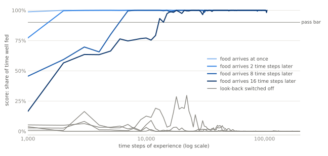
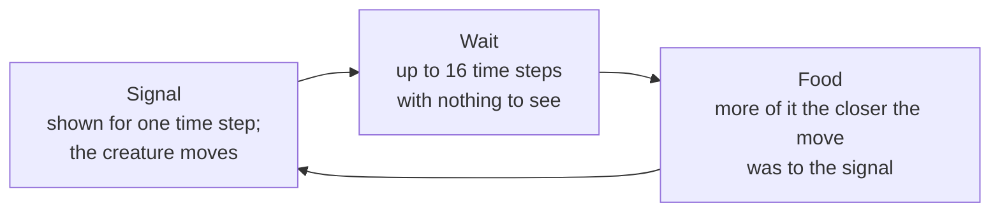

# predictive-coding-agent

**A small neural network that learns to act now for a payoff that comes later.** Nobody gives it a score, and it
never tries moves at random. It is built with one goal, to keep one thing it senses (how full it is) in a
comfortable range, and it learns the rest by predicting what it will sense next and correcting its own mistakes.

> **For researchers.** The agent learns one-step predictions on two clocks: every tick, and its own events. Its
> action is inferred while its state settles. The movement descends a function of free-energy form in which the
> preferences are priors, taken in the limit where they move the body and reach the state only through that
> movement. In that limit the slope is the gradient of the preferences' cost through the agent's own forward
> mapping. An expected free energy is also written for one anticipated outcome, and the movement follows the
> slope of its uncertainty terms, which include the information the outcome would give about the forecast's own
> weights. In reinforcement-learning terms the tasks are contextual bandits with delayed feedback, and the agent
> is an on-policy Monte Carlo forecast of the change in an interoceptive variable up to the next event, with
> action through the learned forward model and a computed exploration bonus. No reward is delivered and no
> value is bootstrapped. It is not active inference in the full sense: perception does not feel the
> preferences, learning does not descend the function, and in these tasks the information term is a cost.
> [The precise claims and their limits](#for-researchers)

<picture>
  <source media="(prefers-color-scheme: dark)" srcset="docs/summary-dark.svg">
  
</picture>

*What to see: the full agent (blue) climbs past the pass bar (a score close to a perfect player's, defined
under [Results](#results)) and stays there, at each of four delays between its move and its food. With one part
switched off (gray, the same four delays), it stays at the bottom. The score is the share of the time the agent
keeps itself well fed, counted over 32 copies of it that learn together and share one brain. Each blue line is
the average of three runs that start from random weights, and each gray line is one run. A point covers 1,000
time steps, so learning that happens inside the first 1,000 does not show. The notch near the right edge of the
longest delay is one run that lost the task for 4,000 time steps and found it again. The part switched off is
the look-back explained below.*

## In plain words

**The task.** A simulated creature slowly gets hungry. A signal appears for a single time step and shows it
which way to move. The closer its move is to that direction, the more food it gets, but the food arrives up to
16 time steps later, and nothing happens in between. Then the next signal appears. One round, from signal to
food, is a *trial*. The creature is told none of this. It has to find out that the signal matters, which move
goes with it, and that food arriving now was caused by a move it made a while ago.



**Why that takes something extra.** By the time the food arrives, the moment that earned it is gone, so
something has to connect the two. Learning methods usually do it with a fading record of recent moves, or by
learning how much future reward each situation is worth. This creature keeps one snapshot instead: the last
moment that surprised it.

**How the creature does it.** It is a small neural network, under 900 lines of Python.

- **It has a goal, but gets no score.** It senses how full it is, and it is built with one goal for that sense:
  keep it in a comfortable range and, looking ahead, near the middle of that range. Nothing tells it how good a
  move was, and the goal is never used to teach it. The goal only steers its movement.
- **It learns by predicting.** At every time step it predicts what it will sense next, including how its
  fullness will change. When a prediction turns out wrong, the mistake adjusts its connections. That is the
  only way it learns.
- **It works out its move from its predictions.** Its predictions depend on how it moves. So it asks which way
  of moving would, by its own predictions, bring its fullness back toward the comfortable range, and it turns
  that way. At first its moves are whatever its untrained connections happen to produce. As the predictions
  improve, the moves improve with them. No randomness is added to try things out.
- **One memory bridges the delay.** It remembers the last moment that surprised it, which means a moment when
  what it saw was not what it had predicted. In this task that is the moment of the signal. It keeps what it saw
  and did at that moment, and how full it was. At the next surprise it looks back and measures how its fullness
  really changed in between. If the real change differs from what it expected at the remembered moment, it
  corrects that expectation. The next time the same signal meets the same move, it expects the food, or the lack
  of it, already when it moves, and its goal steers by that. This look-back is called the *hindsight correction*
  in the rest of this page.
- **It is drawn to what it has not learned.** It keeps track of which of its expectations have been tested by
  an outcome and which are still guesses. Where they are guesses, its move is pulled toward finding out, unless
  that puts its goal at too much risk. The pull is worked out from what it knows. It is not a random try. The
  rest of this page calls it the *information term*.

**The result.** Starting from random weights, the agent learned its task in all 27 runs: the task above at
seven delays, and a second task with two needs. In every run it then kept the task for at least 100,000 more
time steps. (One run lost it after 138,000 and had it back 4,000 time steps later.) Longer delays took longer to
learn. Before the task was learned, a copy of the creature went hungry for about 150 to 250 trials on average at
delays of 0 to 2, and for about 260 to 420 at delays of 4 to 16, apart from one slow run at about 830.

**What the last part costs.** The pull toward the untested does not pay for itself in this task. With it
switched off, the creature still learned the task in all 27 runs. On the way it spent less than a third as long
outside its comfortable range, and its score dipped less often afterward. The task never requires it to try
something new: any move that is partly right is partly fed. The pull is part of the agent because the theory it
is built on says an agent should have one. A task that needs it was not run.

**Without the look-back.** The usual test of a part like the look-back is to switch it off and see whether
the task is still learned. In that test, the *control*, the agent never learned the task in any of five runs.
That shows it depends on the look-back. It does not show that the delay is the reason: the switched-off agent
also failed with no delay at all, and why was not tracked down.

**What this is, and is not.** It is a small proof of concept, not a benchmark result. A standard method, given
a reward, would be expected to solve a task of this size, and none was run here. What it shows is narrower: an
agent whose only goal is a preferred range for one thing it senses can learn that a signal, a move and a later
outcome belong together, in a task where each outcome follows one decision.

## Results

From here on a time step is called a *tick*. The agent played two games. The *cue game* is the task above,
run at seven delays from 0 to 16 ticks. In the *two-need game* the creature has two needs, food and water,
offered in two different directions on every trial. A bite can overfill a need, so the right move is sometimes
to take less, or nothing. Each combination was run three times from different random weights.

How a run is judged:

- The **score** is the share of the agent's 32 copies that are inside the comfortable range, averaged over each
  1,000 ticks. (The code and the pages under `docs/` call the copies *bodies* and the range the *comfort band*.)
- The **pass bar** is set 90% of the way from a floor to the score of a perfect player. The floor is the best
  score of a player that ignores the key information: the signal in the cue game, its own fullness in the
  two-need game.
- A run has **mastered** a game when three 1,000-tick windows in a row are at or above the bar.

<!-- summary:begin -->
| Game | Delay (ticks) | Runs that mastered it and held it | Ticks to mastery, in each run |
|---|---|---|---|
| cue | 0 | 3 of 3 | 2,000, 2,000, 2,000 |
| cue | 1 | 3 of 3 | 2,000, 5,000, 2,000 |
| cue | 2 | 3 of 3 | 3,000, 3,000, 3,000 |
| cue | 4 | 3 of 3 | 4,000, 4,000, 4,000 |
| cue | 8 | 3 of 3 | 9,000, 9,000, 8,000 |
| cue | 12 | 3 of 3 | 9,000, 9,000, 15,000 |
| cue | 16 | 3 of 3 | 13,000, 12,000, 12,000 |
| two-need | 1 | 3 of 3 | 1,000, 1,000, 1,000 |
| two-need | 2 | 3 of 3 | 2,000, 2,000, 1,000 |
<!-- summary:end -->

- **All 27 runs mastered the game and held it** for 100,000 ticks or more.
- **A longer delay took longer to learn.** Mastery took 1,000 to 15,000 ticks, which is seconds to a few minutes
  of computing on one CPU core. Counted in trials the difference is smaller. Before mastery a copy spent, on
  average, 152 to 253 trials outside its comfortable range at delays of 0 to 2, and 259 to 424 at delays of 4
  to 16, apart from one run at 831.
- **After mastery the score mostly stayed up.** Across all runs, 3,455 windows of 1,000 ticks came after
  mastery. The score was below the bar in 19 of them, in 8 of the runs. Four of those windows are in a row, in
  the one run that lost mastery late and regained it.
- **The information term is a cost in these games.** The same agent without it also mastered and held all 27
  runs. Before mastery its copies spent 15,088 ticks each outside the comfortable range, summed over the runs,
  against 53,615 with the term: the term costs about 3.6 times as much, and more in every one of the 27 pairs
  of runs. The times to mastery (75,000 ticks summed, against 140,000) understate this, because they are
  counted in windows of 1,000 ticks and 13 of the 27 runs without the term mastered inside the first one.
  After mastery 3 of its windows were below the bar, against 19.
- **The control never mastered a game.** The same agent with the hindsight correction switched off was run
  five times, for 200,000 ticks each. None reached the bar, including one with no delay at all.

The full tables, the comparison with and without the information term, the control and what it does not show, and
every curve are in [docs/results.md](docs/results.md). The agent published here was also checked, tick for
tick, against the research program that produced the curves:
[how the numbers were checked](docs/results.md#how-the-numbers-were-checked).

## For researchers

**The claim.** An agent whose only objective is a preferred range for an interoceptive variable (two of them
in one of the games) learns a contingency between a cue, an action and a delayed outcome from prediction errors
alone, in tasks where events are sparse and one outcome follows one decision. Its action is inferred as the
descent of a written function of free-energy form. No reward is delivered, no value is bootstrapped, no noise
is added to actions and no error is sent back through the recurrent weights: one delayed error is applied to
one stored state. These games are easy for reinforcement learning when a reward is given, and no baseline was
run.

**In reinforcement-learning terms.** Both games are contextual bandits with delayed feedback. The outcome
forecast is a general value function on an event clock: an on-policy Monte Carlo prediction of one cumulant,
the change in fullness, up to the next event. It is split into a baseline fitted across the bodies and a part
read from the state. The remembered moment is a one-slot eligibility trace. The action is a point estimate,
found at decision time by gradient descent on the two preferences' cost (the band's cost on the one-tick
forecast, and a quadratic cost on the outcome forecast) through the learned forward mapping (compare Jordan and
Rumelhart, 1992), with a computed exploration bonus built from counts of how often each feature of the
forecast has been corrected. In the cue game the forecast is functionally a one-step value.
[Reinforcement learning](docs/theory.md#reinforcement-learning)

**Against predictive coding and active inference.** The agent keeps their outline: the senses drive the state
only as the errors of a forecast, every weight learns from a prediction error, and no policies are compared.
Its goals are prior preferences in form, and they sit inside one function of free-energy form, of the movement
and of a second copy of the state. The agent takes that function in the limit where the state is infinitely
precise against the preferences, so the preferences move the body and do not bias what is perceived, and the
movement follows the limit of the function's slope. In that limit the slope is exactly the gradient of the
preferences' cost through the agent's own forward mapping. No member of the finite-precision family was run,
and the function is not derived as a bound on surprise under a generative model. An expected free energy is
also written for one anticipated outcome: the expected cost under the forecast's uncertainty about its own
weights, less the information the outcome would give about them. The slope of its uncertainty terms is added
to the movement directly and is not weighted like the rest, so the movement does not descend the sum.

It is not active inference in textbook form. Perception does not feel the preferences. Learning does not
descend the function: each weight follows a prediction error by a delta rule. The function holds two
quantities from perception as fixed parameters. The uncertainty behind the information term is a count kept
beside the weights, and it does not set how fast those weights learn. The precision of the setpoint is set by
hand, and a hold scales both preferences from tick to tick.
[Predictive coding](docs/theory.md#predictive-coding) · [Active inference](docs/theory.md#active-inference)

What may be worth a closer look:

- **Prediction and preference are kept apart.** The weights learn to predict the fullness. No weight learns
  from the cost: the setpoint is applied only when the agent acts. A change of setpoint should therefore change
  behavior before anything is relearned, which a cached value would not do. This was not tested.
  [In words](docs/how-it-works.md#the-goal-is-a-preferred-range) ·
  [in equations](docs/equations.md#the-two-preferences)
- **Action as inference, with no policy and no sampling.** While the state settles, the movement descends the
  function above. In the limit taken, its slope is the preferences' push on the units, passed through the
  units' own time constant and carried from the active units through the transpose of the movement's own input
  weights. Those weights are trained by prediction errors, so that is where the mapping from cue to movement is
  learned. The descent is 39 annealed steps (the settle's 40, less the first), taken while the state is itself
  still settling.
  [In words](docs/how-it-works.md#the-movement-is-inferred-not-selected) ·
  [in equations](docs/equations.md#the-movement)
- **An information term, with its price.** For the anticipated outcome the agent writes the expected free
  energy `½ κ ((x* − X)² + σ_w²) − ½ ln(1 + σ_w² / σ_o²)`: `x* − X` is the forecast's miss of the setpoint,
  `κ` the setpoint's precision, `σ_o²` the forecast's running squared error, and `σ_w²` its uncertainty about
  its own weights, kept as a count per unit of how often that unit has been corrected. The slope of the two
  terms in `σ_w²` is added to the movement's vote. Whether the unfamiliar is sought or avoided falls out of
  those two terms and the hand-set precision. In these two games the term multiplies the time spent outside
  the band before mastery by about 3.6 (2.0 to 10.1 by game and delay, and more in every one of the 27 pairs
  of runs) and makes the held score less steady. The runs without it are in the results file.
  [In words](docs/how-it-works.md#the-movement-also-seeks-information) ·
  [in equations](docs/equations.md#the-information-term) ·
  [what it costs](docs/results.md#what-the-information-term-costs)
- **A delayed outcome is attributed to the latest event.** A tick is an event when sight or movement was
  predicted neither by the forecast nor by its running mean. The state stored at one event is given, at the
  next, the measured change in fullness as its target. In these games the events are exactly the cue ticks, so
  segmentation by prediction error was not put to a test.
  [In words](docs/how-it-works.md#anticipation-corrected-in-hindsight) ·
  [in equations](docs/equations.md#events-outcomes-and-the-hindsight-error)
- **Regulation is anticipatory, toward a fixed setpoint.** The movement at a cue is set by a learned forecast
  of where the fullness will be at the next event, so a move that gives up the next meal is already wrong when
  it is made.
  [In words](docs/how-it-works.md#the-anticipation-has-a-setpoint-of-its-own) ·
  [relation to interoceptive inference](docs/theory.md#active-inference)
- **One ablation, and what it does not show.** With the hindsight correction off, no run reaches the bar. That
  includes the run with no delay, where nearly every tick is an event and the two forecasts have the same
  target. So the ablation shows that the agent needs the event path as it is built: its fixed gain, its point
  setpoint, its faster rate, its fitted line, its step into the input weights, and with them the information
  term. It does not show that reaching across the delay is what that path contributes.
  [The control](docs/results.md#the-control)
- **What is built in by hand.** The cost and its setpoint, a privileged interoceptive channel, three hand-shaped
  gains where a precision would stand (the attention gain, the weight between the two preferences and the
  setpoint's fixed gain; none is an estimated inverse variance, and the third is a fixed one), a learning-rate
  gate, a hold on quiet ticks, a baseline fitted across the 32 bodies, and about 40 constants chosen on these
  two games.
  [What is built in](docs/limits.md#what-is-built-in) ·
  [what would test it further](docs/limits.md#what-would-test-it-further)

## How it works

1. **Predict.** A sparse internal state (256 threshold units) predicts the next tick's senses, including the
   change in fullness. The error of that prediction drives the next state, and every weight learns from a
   prediction error.
2. **Settle.** On each tick the state is found by a short relaxation in which units with overlapping inputs
   compete. A second, smaller level predicts the first.
3. **Act.** During that settling the movement is inferred. The agent reads the slope of its preference at the
   fullness it forecasts, and the movement turns the way that would bring the forecast back toward the comfort
   range. The preferences act on the movement only, and reach the state in no other way. Nothing is searched
   or sampled.
4. **Remember one moment.** A tick is eventful when what the agent saw or did was news to it. Each body keeps
   its latest eventful moment: its state then, and its fullness.
5. **Correct in hindsight.** At the next eventful moment the agent measures how its fullness changed since the
   remembered one, and corrects what that moment should have forecast. The forecast has a setpoint of its own,
   so a move that would give up the next meal already looks wrong when it is made.
6. **Seek information.** The agent counts how often each unit has been part of a corrected forecast. Where the
   forecast is still untested, the movement is also pulled toward the states that would test it, weighed
   against the cost that the uncertainty adds to its goal.

Every part in words: [docs/how-it-works.md](docs/how-it-works.md). Every update rule:
[docs/equations.md](docs/equations.md).

## Try it

```bash
git clone https://github.com/cabloo/predictive-coding-agent
cd predictive-coding-agent
pip install torch --index-url https://download.pytorch.org/whl/cpu
python -m pcagent.run --game cue --delay 2 --seed 1 --ticks 6000
```

```text
cue game, delay 2, seed 1: oracle 1.0000, floor 0.0016, bar 0.9002
tick    1000  score 0.533  below  (30 ticks/s)
tick    2000  score 0.747  below  (30 ticks/s)
tick    3000  score 0.995  at or above the bar  (30 ticks/s)
tick    4000  score 1.000  at or above the bar  (30 ticks/s)
tick    5000  score 1.000  at or above the bar  (30 ticks/s)
tick    6000  score 1.000  at or above the bar  (30 ticks/s)
mastered at tick 3000; held >= 3000 ticks, R >= 1.0; held: undetermined (the run ended first)
```

The last line says that the run mastered the game at tick 3,000, the first of three windows in a row at or
above the bar, and that 6,000 ticks are too few to say whether it held. Without `--ticks` a run goes on for
100,000 ticks after mastery, which is how the results were produced. `R` is the time mastery lasted divided by
the time it took to reach, and a game counts as held when `R` is at least 10.

The agent runs at 30 to 58 ticks per second on one CPU core, depending on the machine, so this short run takes
two to four minutes and a complete one 30 minutes to an hour. Add `--no-information` for the agent without the
information term, and `--no-hindsight` for the control.

In code, the agent needs nothing from a game except its three senses:

```python
from pcagent import Agent, CueGame

game = CueGame(32, seed=1, delay=4)                # 32 bodies, the outcome 4 ticks after the answer
agent = Agent(game.n_extero, game.n_proprio, game.n_intero, seed=1)
for tick in range(10_000):
    movement = agent.step(game.extero(), game.proprio(), game.intero())
    game.step(movement)
print(game.score())                                # share of bodies in the comfort band
```

Tests: `pip install pytest`, then `pytest -m "not slow"` (under a minute) or `pytest` (adds two learning runs,
two to three minutes).

## Limits

- **Two small games.** The senses are 5 to 8 numbers and the movement is a direction in a plane. Nothing here
  shows that the method scales.
- **No baseline.** A standard reinforcement-learning agent, given a reward, would be expected to solve both
  games. None was run.
- **The control does not isolate the delay.** It fails with no delay too, so it shows that the agent needs the
  hindsight path, not why.
- **The information term is not shown to help.** In these games it costs time and steadiness, and no task here
  needs it.
- **The games hand the agent its events.** The eventful moments are exactly the signal ticks, and one outcome
  follows one decision. Finding events by surprise was not put to a test.
- **Holding back is barely tested.** In the cue game the fullness never rises past the setpoint, so more food
  is always right. Only the two-need game asks the agent to decline, and only at delays of 1 and 2 ticks.
- **A fixed, blank wait of at most 16 ticks.** Varying delays, longer delays and distractions during the wait
  were not tested.
- **One remembered moment.** An outcome is credited to the latest eventful moment only.
- **Much is set by hand, and there are three seeds.** The goal, a privileged sense of fullness, a baseline
  shared by the 32 copies, and about 40 constants that are the same for every run but were chosen on these two
  games.

The full list, and the experiments that would test the idea further: [docs/limits.md](docs/limits.md).

## In this repository

| Where | What |
|---|---|
| [`pcagent/agent.py`](pcagent/agent.py) | The agent: state, settling, the movement, the learning rules, anticipation and memory |
| [`pcagent/memory.py`](pcagent/memory.py) | When a tick is eventful, and the line that forecasts an outcome from the fullness |
| [`pcagent/worlds.py`](pcagent/worlds.py) | The two games, and the reference policies that set the floor and the oracle |
| [`pcagent/scoring.py`](pcagent/scoring.py), [`run.py`](pcagent/run.py), [`report.py`](pcagent/report.py) | The pass bar and mastery, the runner, and the tables |
| [`results/acceptance.json`](results/acceptance.json) | The 27 learning curves, the 27 without the information term, and the 5 control curves |
| [`docs/how-it-works.md`](docs/how-it-works.md) | Every part of the agent, in words |
| [`docs/equations.md`](docs/equations.md) | Every update rule, with the function that implements it |
| [`docs/results.md`](docs/results.md) | Full results, what the information term costs, the control, and how the numbers were checked |
| [`docs/theory.md`](docs/theory.md) | Relation to predictive coding, active inference and reinforcement learning, with references |
| [`docs/limits.md`](docs/limits.md) | What was not shown, what is built in, and what would test it further |
| [`tests/`](tests) | The games, the scoring, the agent's invariants, and that these pages match the results file |

Every default of `Agent(...)` is the value the results were run with; its docstring says what each one does.

## License

[MIT](LICENSE).
