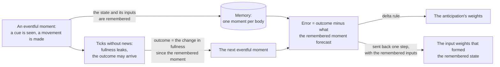

# How the agent works

This page explains every part of the agent in [`pcagent/agent.py`](../pcagent/agent.py), in words. The code
marks its parts as "Idea 1" to "Idea 13", and the same numbers are given here. The same parts as update rules
are in [equations.md](equations.md). For the short account, see the [README](../README.md); for how the design
relates to predictive coding, active inference and reinforcement learning, see [theory.md](theory.md).

- [The task in detail](#the-task-in-detail)
- [One tick, start to finish](#one-tick-start-to-finish)
- [Predicting the next senses from a sparse state](#predicting-the-next-senses-from-a-sparse-state)
- [The state is found by settling](#the-state-is-found-by-settling)
- [The input weights learn from the forecast's error](#the-input-weights-learn-from-the-forecasts-error)
- [The goal is a preferred range](#the-goal-is-a-preferred-range)
- [The movement is inferred, not selected](#the-movement-is-inferred-not-selected)
- [Anticipation, corrected in hindsight](#anticipation-corrected-in-hindsight)
- [The anticipation has a setpoint of its own](#the-anticipation-has-a-setpoint-of-its-own)
- [Each error is weighted by its own precision](#each-error-is-weighted-by-its-own-precision)
- [Regulators](#regulators)
- [The switch](#the-switch)

## The task in detail

Time moves in ticks. On every tick the agent senses three things and returns a movement:

| Sense | What it is | Size |
|---|---|---|
| Sight | the cue, or blank | 2 or 4 numbers |
| Last movement | the direction the body just moved | 2 numbers |
| Fullness | one number per need | 1 or 2 numbers |

A trial lasts `delay + 1` ticks, and trials follow each other without a gap:

1. **Cue tick.** A direction is shown (east, north, west or south). The movement made on this tick is the answer.
2. **The wait.** Sight is blank for `delay` ticks, and movements do not change the outcome.
3. **The outcome.** At the end of the wait, fullness rises by an amount that depends on how close the answer was
   to the cue: all of the bite for the exact direction, half of it at 45 degrees off, none at 90 degrees or more.

Fullness leaks away on every tick. The agent's comfort band is 0.5 to 1.0, and the score is the share of bodies
whose fullness is inside the band. 32 bodies run in parallel and share one set of weights.

The agent is told none of the rules. It is not told that trials exist, how long the delay is or which tick
carries a cue, and it is never given its score. It is built with the comfort band, which is the band the score is
computed from. At any delay above 0, no food arrives when the agent moves. By the time the food
arrives, the cue has been out of sight for `delay` ticks. Whether the agent can learn this without its memory of
one moment is what [the control](results.md#the-control) tests.

There are two games, both in [`pcagent/worlds.py`](../pcagent/worlds.py):

- **The cue game.** One need, one cue. Tested at delays of 0, 1, 2, 4, 8, 12 and 16 ticks.
- **The two-need game.** Food and water are offered in two different directions on every trial. The body can take
  one, a share of each when the two are 90 degrees apart, or neither. A bite can push a need above the band, so
  declining is sometimes right. The two needs leak at different rates that change every 20 trials. The best of
  14 reference policies that ignore the body's fullness (among them eight fixed schedules of eating, drinking
  and skipping) scores 0.44 at a delay of 1 and 0.43 at a delay of 2, the two delays tested.

## One tick, start to finish

One call to `Agent.step` is one tick. In order:

1. **Prediction error.** The senses are compared with what the previous state forecast for them. The difference
   is the prediction error. (The code's comments call it the surprise.)
2. **Learning from the last tick.** The forecast made on the previous tick is now known to be right or wrong,
   so the forecast weights and the input weights that formed the previous state learn from its error, each
   sensed channel's error weighted by that channel's own precision.
3. **Settling, twice.** The new state is found by a relaxation driven by the prediction error, the previous
   state, the movement and the anticipation fed back from the last tick. In the first relaxation the movement is
   inferred, and the second level's prediction is part of the input. It gives the movement. The second, with
   that movement fixed and the second level's prediction left out, gives what the agent perceives.
4. **The second level.** It learns to predict the first level's state, then settles on the error of that
   prediction.
5. **Memory.** Every body adds this tick's change in fullness to its open outcome. A body for which this tick
   is news closes the moment it remembered, which corrects one forecast in hindsight, and stores the new one.

The movement from step 3 is returned.

## Predicting the next senses from a sparse state

The state is 256 units, each with a threshold that adapts toward the unit being active on about 6% of ticks. A
linear forecast reads the state and predicts the next tick's senses, and learns from its error by a normalized
[delta rule](https://en.wikipedia.org/wiki/Delta_rule). The agent also computes the change in its fullness since
the last tick and forecasts it like a sense. The last movement is known, so it is copied, not forecast.
*(Ideas 1 and 2; [in equations](equations.md#the-forecast-and-its-error))*

## The state is found by settling

On each tick the units are driven by the prediction error, by the previous state and by the movement. The
prediction error is this tick's senses minus what the previous state forecast for them (the forecast's constant
term is left out here; it is used when the weights learn and, for the change in fullness, where the comfort band
is read). Units whose input weights overlap inhibit each other. Forty small steps of this relaxation give the
state.

The relaxation runs twice per tick. In the first, the second level's prediction is part of the input and the
movement is inferred as the units relax ([below](#the-movement-is-inferred-not-selected)); it gives the movement
and the state the forecast reads. The second has that movement fixed and no prediction from the second level;
it gives the state that the second level predicts and that memory stores. The goal is in the input of neither:
it acts on the movement only.
*(Idea 3; [in equations](equations.md#settling))*

## The input weights learn from the forecast's error

The error is sent back one step through the forecast weights to the units that were active, and each of those
units changes its input weights by that error times the input it had (for the error itself, the error
without its attention gain). The error is weighted by precision first,
as for the forecast weights ([below](#each-error-is-weighted-by-its-own-precision)). A second level of 64 units
predicts the first level's state in the same way, without precision, and sends its prediction back down.
*(Ideas 4 and 5; [in equations](equations.md#learning-on-every-tick))*

Nothing in the agent is differentiated automatically. Every update is written out by hand, and a test checks
that the source never asks for a gradient.

## The goal is a preferred range

Outside the comfort band a cost grows with distance: the distance past the nearer edge, plus its square over the
band's width. Inside the band the cost is zero. The agent never receives this cost. It reads the *slope* of the
cost at the fullness it forecasts for the next tick, averaged over how uncertain that forecast is (it learns
the forecast's variance too). *(Idea 6; [in equations](equations.md#the-two-preferences))*

## The movement is inferred, not selected

While the state settles, the movement is inferred along with it. The agent's preferences are written as priors
in one function of free-energy form, and the movement follows that function's slope.

**The push.** The slope of the cost is carried through the forecast weights to the units. That gives, for every
unit, a *push*: how much the forecast fullness would move back toward the band if that unit were more active.

**The function.** Besides the movement, the function has one more argument: a second copy of the state, which
the preferences are allowed to pull on. It charges for two things. One is the copy differing from the state
that the input alone settles on. The other is the copy's forecasts of fullness missing the preferences. If the
first charge were small, the preferences would bend what the agent perceives toward what it wants. The agent
takes the opposite limit: the first charge is made infinitely steep, so the copy cannot leave the state at all.
There is then one state, formed by the input alone, and the preferences move the body and nothing else. In
that limit the function's slope is the slope of the preferences' cost itself, carried back from the units to the
movement through the agent's own weights.

**The lean.** One thing survives that limit: how hard the preferences lean on each unit. The *lean* is the push,
read on the state as it stands and smoothed by the same time constant the units relax with. In the limit, the
slope of the function in the movement is the lean of the active units, carried through the movement's own input
weights. That gives a direction, and the movement turns toward it: fast early in the settle, slowly late. It
does not turn on the first settle step, when no unit is active yet.

There is no list of candidate movements, no search and no sampling, and no distribution over movements is
learned or updated. The movement is a point estimate. The slope it follows is the function's own, with two
things the function takes from perception as fixed numbers and does not differentiate: the inhibition between
units, as the state has settled it, and the forecast's variance. The descent is 39 annealed steps (the settle's
40, less the first), taken while the state is itself still settling, so the movement returned is where that
descent stands at the end and not a minimum. The function, and what it leaves out, are in
[theory.md](theory.md#active-inference).

The movement's input weights do double duty. Forward, the movement drives the state through them. Backward,
their transpose carries the lean to the movement. They learn from prediction errors like the other input
weights, so the mapping from a cue to a movement is learned there and in the forecast weights, not in a separate
policy. No noise is added to the movement. Before anything is learned, the movements are whatever the random
initial weights produce.
*(Idea 7; [in equations](equations.md#the-movement). Idea 8 is a detail of the forecast of the change in
fullness: it reads the state with its mean over the active units removed.)*

## Anticipation, corrected in hindsight

This is the part that reaches across the delay.

- **One more prediction.** One more set of weights reads the state and gives the anticipation, `a = Ca · z`: the
  state's part of the forecast of the change in fullness up to the next eventful moment.
  Its value is fed back into the state on the next tick, through input weights of its own. *(Idea 9)*
- **Memory holds one moment.** A tick is eventful for a body when its sight or its movement was news: predicted
  neither by the forecast nor by the running average. The fullness is not counted as news. Each body remembers
  its latest eventful moment: the state, the inputs that formed it, and its fullness. The agent is not told
  which ticks matter. In these two games the body does exactly what it is told, so its movement is never news,
  and sight is blank between cues, so no tick between two cues is eventful. Nearly every cue tick is: a cue
  that the forecast had already partly predicted for that body can fall below the bar, and that body's
  remembered moment then stays open over two trials. Over the first 30,000 ticks of every run that happened
  on 2,367 of 8,967,072 cue ticks of a body (0.03%), and none of the 16,952,928 ticks of a body between cues
  was eventful. At a delay of 0 a cue arrives on every tick, and nearly every tick is
  eventful. *(Idea 10)*
- **The outcome is the change in fullness.** Between two eventful moments, each body adds up its changes in
  fullness. The sum is the outcome `G`: the fullness at the next eventful moment minus the fullness at the
  remembered one. It holds what leaked away over the interval and whatever was eaten.
- **The forecast of an outcome has two parts.** One is a line read from the fullness at the remembered moment,
  `slope × fullness + offset`, fitted across the bodies to the outcomes themselves. It carries what the fullness
  alone tells, which is mostly the leak and the usual meal. It is a baseline fitted across the bodies: one body
  alone could fit only its offset, not its slope. The other part is the anticipation, read from the remembered
  state. It is left with what the line cannot tell: what this cue and this movement change.
- **Hindsight sets a target.** When the next eventful moment arrives, the error is `G` minus the line minus
  `a(remembered state)`, with the anticipation read from the remembered state by the weights as they are now.
  The anticipation's weights step by that error with the delta rule, at three times the forecast's rate,
  weighted by the error's own precision, and with a limit on the step; where the limit binds, it sets the
  step's size and the precision does not change it. The same error, sent back one step,
  corrects the input weights that formed the remembered state, using the remembered inputs and the same
  precision; the input weights from the anticipation take the same step, with the anticipation that was fed in
  at that moment. The line moves a twentieth of the way toward the least-squares fit of the outcomes, across
  the bodies that close a moment on that tick. No other weight is corrected.
- **What is read when the agent acts.** The remembered moment is never read when the agent acts. Running
  statistics kept beside it are read instead: how much outcomes vary and how well the forecast predicts them.

"Hindsight" names this one correction. It is not hindsight experience replay, and it is not hindsight credit
assignment in the sense of Harutyunyan et al. (2019); see [theory.md](theory.md#reinforcement-learning).
*([In equations](equations.md#events-outcomes-and-the-hindsight-error))*

## The anticipation has a setpoint of its own

The comfort band is read on `fullness + forecast change`, one tick ahead. The anticipation adds a second read,
with a point as its goal: the fullness expected at the next eventful moment, `fullness + line + a`, should sit
in the middle of the band. Its error is counted in half-widths of the band. A movement that would give up the
next meal is therefore already wrong when it is made, and one that would overfill is wrong too.

The forecast behind this read is trained only at eventful moments, but it is read on every tick, from the state
as it settles.

The push behind the lean has two terms. The first is the band's slope, through the weights that
forecast the next change in fullness. Its weight is the one-tick forecast's share of the two forecasts' skill,
`(s1 + 0.05) / (s1 + sG + 0.05)`, where a skill is the fraction of a target's variance its forecast explains.
The second is the setpoint's error, through the anticipation's weights, multiplied by a fixed gain of 8.
*(Idea 11; [in equations](equations.md#the-two-preferences))*

## Each error is weighted by its own precision

Some of what the agent senses it can learn to forecast closely, and some it cannot. The agent learns from each
error in proportion to how reliable that kind of error has been. *(Idea 13;
[in equations](equations.md#each-errors-precision))*

- **One precision per error.** Each sensed channel's one-tick error keeps a running average of its square. Its
  *precision* is the inverse of that average: large for a channel the forecast usually gets right, small for one
  it usually misses. Memory's error at the moments it closes has one precision of its own, kept the same way.
- **It sets how much is learned.** When a weight learns from an error, the error is first multiplied by its
  precision. A channel that is usually well forecast is learned from up to ten times as fast as its base rate; one
  that is usually missed by a unit or more is learned from at the base rate. That holds for the forecast weights,
  the input weights of the first level (from the error, the movement, the last state and the anticipation) and
  memory's corrections of the anticipation's weights and of the input weights. The fit of the line, the second
  level, the thresholds and the weights that learn the forecast's variance take no precision.
- **It does not set how the state settles.** The errors that drive the state are not multiplied by precision,
  and the movement is not affected by it except through what the weights have learned.
- **Read before the error it weights.** On each tick the precision is read from the average as it stood before
  this tick's error was added, so an error never sets its own weight. A channel's first error is weighted at 1
  and starts the average.
- **Kept between 1 and 10.** The inverse of an average squared error is the precision that the textbook
  free-energy treatment of a Gaussian error gives, and it is used as it is, inside two bounds set by hand. The
  floor of 1 keeps a poorly forecast channel at its base rate. The ceiling is 10, and lower if
  the forecast's or the input weights' learning rate is above 0.1, so that neither rate, times its precision,
  exceeds 1. (Memory's correction of the
  anticipation runs at three times that rate and has a limit on its step of its own.)
- **Where it sits in these games.** The errors of the fullness, its change and memory are small in the units the
  games use, so their precisions sit at the ceiling: from their second use for the change and memory, and after its
  first 130 to 180 ticks for the fullness. (The movement is copied, not forecast, so its error is zero and its
  precision scales no step.) Sight's error is large on cue ticks and near zero between them, and one precision
  covers every tick, so it follows how often a cue is shown: about 2 at a delay of 0, near the ceiling at a delay of
  4 and at it from 8 ([results](results.md#where-the-precisions-sat)). In practice, then, precision acts here mostly
  as a tenfold rate.

Nothing global sets how fast the agent learns: each precision scales only the errors it is estimated from, and the
base rates are fixed.

## Regulators

Four regulators keep learning stable *(Idea 12; [in equations](equations.md#gains-and-running-statistics))*:

- an attention gain (1 to 10) on the prediction error of inputs whose error would change the agent's other
  forecasts (it is not an estimate of precision, and it is fixed at 1 for the fullness and its change);
- a hold, set per body on each tick, that keeps up to 90% of the first level's previous potentials through
  ticks with smaller prediction errors than usual;
- first-level thresholds that weigh each tick by the size of its prediction errors;
- a limit on what one eventful moment can do to the running average of the outcome forecast's squared error:
  it takes a moment's sample at no more than 10 times its own value, so a single wild outcome cannot wipe out
  the forecast's measured skill.

## The switch

Switching the hindsight correction off is one argument, `Agent(..., hindsight=False)`. Everything else stays the
same: memory still records moments and outcomes, but corrects no weight, so the anticipation's weights and the
line stay at zero and the second preference has nothing to act through. Memory's precision is still kept, and
no weight takes it. [The control](results.md#the-control) says what that agent does and does not show.
