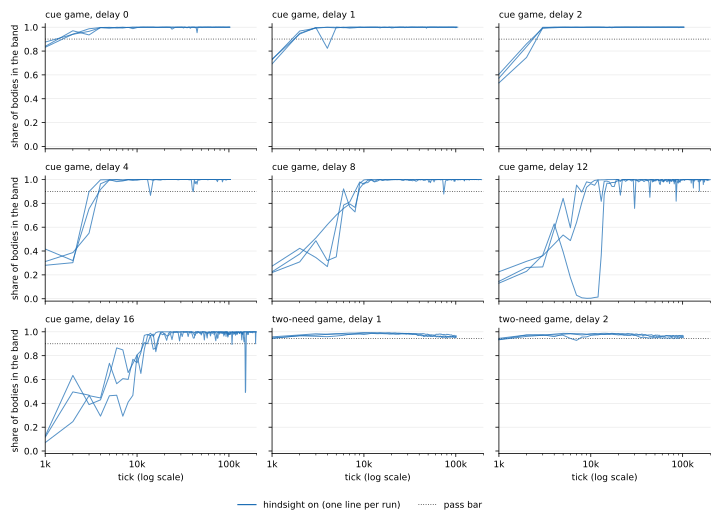

# Results

Every number in the tables and in the sections about the runs comes from
[`results/acceptance.json`](../results/acceptance.json), and a test holds the page to that file.
`python -m pcagent.report results/acceptance.json` prints the tables.

- [How a run is judged](#how-a-run-is-judged)
- [All 27 runs](#all-27-runs)
- [What the information term costs](#what-the-information-term-costs)
- [The control](#the-control)
- [Every curve](#every-curve)
- [Reproducing a row](#reproducing-a-row)
- [How the numbers were checked](#how-the-numbers-were-checked)

## How a run is judged

A score is the mean share of bodies in the comfort band over a window of 1,000 ticks. Each combination of game
and delay has two reference scores, measured on that game:

- the *oracle*, a hand-written policy that knows the rules (1.000 in every case here);
- the *floor*, the best score among policies that ignore what the game is about: a fixed movement and a random
  one, which ignore the cue, and, in the two-need game, twelve policies that read the cues but never the body's
  fullness.

The **pass bar** is 90% of the way from the floor to the oracle. A run has **mastered** the game at the first of
three windows in a row at or above the bar. It then continues for at least 100,000 ticks, or 20 times its time to
mastery if that is longer (runs are capped at 200,000 ticks). The **hold ratio** `R` is how long mastery lasted,
divided by how long it took to reach; mastery ends at three windows in a row below the bar. A run **holds** if
`R ≥ 10`. "≥" means the run ended while still holding.

## All 27 runs

**All 27 runs mastered and held. One of them lost mastery late in its run and regained it.** Time to mastery
ranged from 1,000 to 15,000 ticks, with a median of 3,000.

<!-- results:begin -->
| Game | Delay (ticks) | Pass bar | Mastered at tick, by seed | Hold ratio R, lowest seed | Windows below the bar after mastery | Lowest window after mastery |
|---|---|---|---|---|---|---|
| cue | 0 | 0.900 | 2,000, 2,000, 2,000 | ≥ 50.0 | 0 of 303 | 0.935 |
| cue | 1 | 0.900 | 2,000, 5,000, 2,000 | ≥ 20.0 | 0 of 303 | 0.949 |
| cue | 2 | 0.900 | 3,000, 3,000, 3,000 | ≥ 33.3 | 0 of 303 | 0.991 |
| cue | 4 | 0.900 | 4,000, 4,000, 4,000 | ≥ 25.0 | 2 of 303 | 0.867 |
| cue | 8 | 0.900 | 9,000, 9,000, 8,000 | ≥ 20.0 | 1 of 523 | 0.878 |
| cue | 12 | 0.900 | 9,000, 9,000, 15,000 | ≥ 12.3 | 5 of 548 | 0.758 |
| cue | 16 | 0.900 | 13,000, 12,000, 12,000 | 11.5 | 9 of 566 | 0.491 |
| two-need | 1 | 0.944 | 1,000, 1,000, 1,000 | ≥ 100.0 | 0 of 303 | 0.944 |
| two-need | 2 | 0.943 | 2,000, 2,000, 1,000 | ≥ 50.0 | 2 of 303 | 0.928 |
<!-- results:end -->

Reading the table:

- **A longer delay takes longer to learn in ticks, and less clearly in trials.** In the cue game, mastery takes
  2,000 to 5,000 ticks at delays of 0 to 4, and 8,000 to 15,000 ticks at delays of 8 to 16. That measure is
  coarse: it is taken to the nearest 1,000 ticks, and 4 of the 27 runs mastered inside the first window. A finer
  one comes from the same curves. One minus the score, summed over the windows up to mastery, is the average
  number of ticks a body spent outside the band before mastery, and a trial is `delay + 1` ticks. In the cue
  game a body spent 184 to 227 trials outside the band at a delay of 0, 152 to 253 at 1, 181 to 242 at 2, 304 to
  358 at 4, 369 to 424 at 8, 268 to 831 at 12, and 259 to 351 at 16. (There every body starts inside the band,
  at 0.75, and leaves it within two trials if it eats nothing.)
- **One seed was slow at a delay of 12.** Seed 3 mastered at 15,000 ticks, where the other two seeds took
  9,000, and spent 831 trials outside the band, where they spent 268 and 326. Its score rose to 0.628 by tick
  4,000, fell below 0.02 from tick 8,000 to tick 12,000, and then rose past the bar.
- **After mastery the score dips now and then.** 19 of 3,455 windows over all runs fell below the bar after
  mastery, the lowest 0.491. They are spread over 8 of the 27 runs: 7 in the cue game at delays of 4 to 16, and
  1 in the two-need game at a delay of 2.
- **One run lost mastery and regained it.** In the cue game at a delay of 16, seed 3 mastered at tick 12,000 and
  held for 138,000 ticks. Then four windows in a row fell below the bar, at ticks 150,000 to 153,000 (0.790,
  0.491, 0.503 and 0.690). The score was back above the bar in the next window and stayed there for the rest of
  the run, except for one window just under it (0.9000 against a bar of 0.9001). By the rule above that run's
  mastery ended at tick 150,000, with `R` = 11.5, so it counts as held. It is the only run whose `R` is not
  marked "≥".

## What the information term costs

The agent's movement follows two things: its preferences, and a term that seeks information about what its
outcome forecast has not learned ([how](how-it-works.md#the-movement-also-seeks-information)). Each of the 27
runs was repeated with that term switched off (`information=False`) and everything else the same.

**In these two games the term is a cost.** Without it the agent also masters and holds all 27 runs, with less
than a third of the time outside the band on the way, fewer dips afterward and no loss of mastery.

<!-- comparison:begin -->
| Game | Delay (ticks) | Held, with the term | Held, without it | Ticks outside the band before mastery, mean of the seeds, with | without | Ticks to mastery over the seeds, with | without | Windows below the bar after mastery, with | without |
|---|---|---|---|---|---|---|---|---|---|
| cue | 0 | 3 of 3 | 3 of 3 | 200 | 58 | 6,000 | 3,000 | 0 | 3 |
| cue | 1 | 3 of 3 | 3 of 3 | 390 | 39 | 9,000 | 3,000 | 0 | 0 |
| cue | 2 | 3 of 3 | 3 of 3 | 620 | 156 | 9,000 | 5,000 | 0 | 0 |
| cue | 4 | 3 of 3 | 3 of 3 | 1,634 | 304 | 12,000 | 7,000 | 2 | 0 |
| cue | 8 | 3 of 3 | 3 of 3 | 3,608 | 1,814 | 26,000 | 17,000 | 1 | 0 |
| cue | 12 | 3 of 3 | 3 of 3 | 6,172 | 1,348 | 33,000 | 16,000 | 5 | 0 |
| cue | 16 | 3 of 3 | 3 of 3 | 5,113 | 1,283 | 37,000 | 18,000 | 9 | 0 |
| two-need | 1 | 3 of 3 | 3 of 3 | 50 | 15 | 3,000 | 3,000 | 0 | 0 |
| two-need | 2 | 3 of 3 | 3 of 3 | 84 | 14 | 5,000 | 3,000 | 2 | 0 |
<!-- comparison:end -->

| Over the 27 runs | With the term | Without it |
|---|---|---|
| Mastered and held | 27 | 27 |
| Ticks a body spent outside the band before mastery, summed over the runs | 53,615 | 15,088 |
| Ticks to mastery, summed over the runs | 140,000 | 75,000 |
| Ticks to mastery, slowest run | 15,000 | 8,000 |
| Runs that mastered inside the first window of 1,000 ticks | 4 | 13 |
| Windows below the bar after mastery | 19 of 3,455 | 3 of 2,847 |
| Runs with at least one such window | 8 | 2 |
| Runs that lost mastery (three windows in a row below the bar) | 1 | 0 |

- **It costs time before mastery in every pair of runs.** The ticks to mastery understate the cost. They are
  counted in windows of 1,000 ticks, and 13 of the 27 runs without the term (4 with it) mastered inside the
  first window, the smallest value the measure can take. The finer measure is the time a body spent outside the
  band before mastery ([above](#all-27-runs)). By it the term costs 3.6 times as much summed over the runs
  (53,615 ticks against 15,088), between 2.0 and 10.1 times by game and delay, and more in each of the 27 pairs
  of runs with the same seed (1.8 to 17.5 times). In ticks to mastery, 23 pairs are slower with the term, 4 are
  equal and none is faster. In the two-need game at a delay of 1 every run of both kinds mastered inside the
  first window; by the finer measure the term costs 3.4 times as much there. In trials: at a delay of 1 in the
  cue game a body spent 152 to 253 trials outside the band with the term and 10 to 26 without it, and at a
  delay of 16, 259 to 351 with it and 65 to 86 without it.
- **It makes the score less steady after mastery,** and the one late loss of mastery is in a run with the term.
  The same combination and seed without the term has no window below the bar. One delay goes the other way:
  all 3 windows below the bar without the term are in the cue game at a delay of 0, where the agent with the
  term has none.
- **What the comparison does not show.** These games do not ask for exploration: the outcome is graded, so a
  movement that is partly right is partly paid. The comparison therefore prices the term where it is not
  needed. It says nothing about a task in which an agent without the term gets stuck on a wrong movement,
  because no such task is in this repository. Nor does it price the term at another weight against the
  preferences: its vote is added to the movement as it is ([equations](equations.md#the-information-term)),
  and no other weighting was run. The agent's other constants were chosen before the term was added.
- **Three seeds.** The two sets were run with the same three seeds per combination, so a difference in one
  combination rests on three pairs of runs. The direction is the same in all 27 pairs.

## The control

The control is the same agent with the hindsight correction switched off (`hindsight=False`). Memory still
records moments and outcomes, but corrects no weight, so the anticipation and the line stay at zero.

**Its runs had not finished when this page was written.** There are five, one run each: the
cue game at delays of 0, 2, 8 and 16, and the two-need game at a delay of 2. They are added to the results file
and to this section when they end.

What the control can and cannot show:

- **It removes the event path as a whole.** With the anticipation's weights at zero, the second preference has
  nothing to act through, so the control acts on the one-tick read of the comfort band alone. Several things
  go with it: the fixed gain of 8, the point setpoint (the band's cost is flat inside the band, and the
  setpoint's error is not), the tripled rate, the line, the hindsight step into the input weights, and the
  information term, which has no evidence to read. The control cannot say which of these matters.
- **The gate is not removed.** The learning-rate gate keeps running in the control. With the anticipation's
  weights and the line at zero it is driven by the size of the outcomes themselves, and it still scales the
  ordinary learning rates between 1 and 10.
- **At a delay of 0, memory is not needed.** There a cue arrives on every tick, nearly every tick is an
  eventful moment, and the outcome is the next tick's change in fullness: the one-tick forecast and the outcome
  forecast have the same target. If the control fails there too, it shows that this agent needs the event path
  as it is built, and not that reaching across the delay is what that path contributes.

## Every curve

*Each panel is one game at one delay. Each point is the mean score over 1,000 ticks, so where a curve starts
above the bar, the learning happened inside the first window. Blue: three runs from different random weights.
Dotted: the pass bar. The runs without the information term are not drawn.*

## Reproducing a row

Run `python -m pcagent.run --game cue --delay 8 --seed 2` (seeds 1 to 3; `--game two-need` for the other game;
`--no-information` for the agent without the information term; `--no-hindsight` for the control). Results are
exactly reproducible on one machine. Across machines, floating-point differences can shift a curve slightly,
because small differences grow during learning.

## How the numbers were checked

The curves were produced by the research version of this agent. The code in this repository is that program
reduced to the one configuration reported here, and the reduction was checked:

- **The agent is the same program.** The research agent and this one were given the same inputs, tick by tick,
  and after every tick each weight, each state value, each running average, the information term's counts and
  the movement were compared. They were bit-identical in 19 runs with the information term (17 of 4,000 ticks,
  in both games, at every delay in the table and with all three seeds at some, and 2 of 20,000 ticks), in 5
  runs of 4,000 ticks without the term and in 5 runs of 4,000 ticks with hindsight off (the five control
  combinations): 148,000 ticks in all. In the runs with the term, it cast a vote on 95% of the ticks.
- **The comparison can fail.** With one constant of this agent changed by one part in a thousand (the gain of 8
  set to 8.008), the first difference appeared at tick 4.
- **One branch was reached only with hindsight off.** The level-1 input weights take the falling side of the
  learning-rate gate. That side differs from the whole gate only while the recent surprise is more than a tenth
  above the usual, which happened on 1,296 of the compared ticks, all in the two-need run with hindsight off,
  and on none of the 128,000 ticks with hindsight on (the ratio stayed under 1.08 there). A unit test
  covers that branch as well.
- **The whole pipeline gives the same curve.** The research harness and `pcagent.run` (this repository's games,
  reference policies, scoring and stopping rule) were run on the same machine. The floor, the oracle, the pass
  bar and every point of the curve were equal: over 20,000 ticks at three combinations with the information
  term, at one without it and at one with hindsight off, and over three shorter runs. A complete run to the
  stopping rule had not finished when this page was written.
- **The games are the same.** For the same movements, both games return the same senses, credits and scores as
  the research versions at five delays each, and the reference scores are equal.

These comparisons need the research program, so they are not among this repository's tests.
